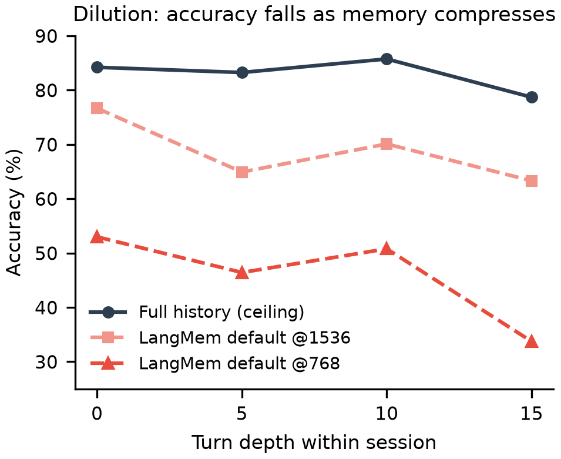
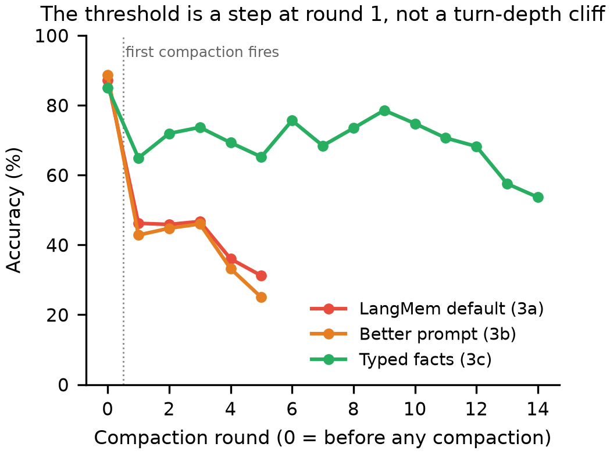
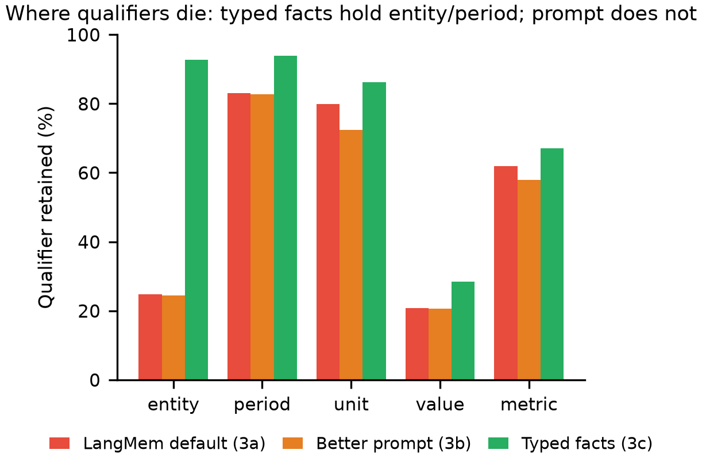

# Lost in Handoff: Memory-Induced Errors in Multi-Agent Financial Document Systems

**Animesh Srivastava**
*AI Centre of Excellence*
*Commonwealth Bank of Australia*
Bengaluru, India
animesh.srivastava@cba.com.au

---

**Abstract** — Financial-document assistants face a memory constraint: context budgets are finite, while an analyst's questions can span many filings and sessions. To keep earlier exchanges available, agents compress conversation history; this can lose the company, fiscal period, or unit needed to interpret a figure. We measure numeric-answer accuracy and qualifier presence under that compaction, and test a memory policy that stores each extracted figure with explicit entity, period, metric, value, and unit fields. We chain ConvFinQA conversations into 115 sessions and compare full history, default prose memory, a qualifier-preserving prompt, and this accumulating typed-fact policy. At a tight compaction trigger, accuracy is 83.9 percent with full history but 48.6 percent with default memory. On 369 identical questions, accuracy is 45.3 percent after the tighter-budget memory has compacted and 82.7 percent before the looser-budget memory compacts. The typed-fact policy reaches 72.4 percent accuracy under forced-answer instructions, recovering about 70 percent of the default policy's gap to full history; answered-but-wrong replies fall from 38.8 to 17.6 percent. A qualifier-preserving prompt shows no comparable gain. A smaller routed multi-agent test also finds a compression penalty. The results show that a typed-fact memory policy can recover much of the answer quality lost under default prose compression in this setting. We release the evaluation sessions, cross-session evaluation pairs, and aggregate results.

**Keywords** — financial question answering, agent memory, summarization, numerical reasoning, structured facts

---

## I. Introduction

An answer such as "revenue was 233" is not a usable financial fact without knowing the company, fiscal period, metric, and scale. Financial assistants increasingly carry information from one question to the next, but a finite context window forces them to shorten earlier exchanges. The output may remain fluent after compression even if a year, company, or unit has disappeared. For a practitioner, an answered but wrong question is especially concerning because it is less visible than a refusal.

We evaluate a fixed answering model on ConvFinQA [1], comparing full conversation history with the shipped prose-summary prompts in LangMem [4], a qualifier-preserving prompt, and an accumulating typed-fact policy. The latter turns older conversation messages into records whose context must be represented explicitly and presents them as a compact fact sheet alongside recent dialogue. Our primary result is a 115-company, single-agent comparison. A smaller routed supervisor-and-specialist test examines whether compression also hurts a multi-agent workflow; it is not a four-condition replication. We also report cross-session tests, including predicted failures that were largely absent.

Our contribution couples a concrete financial-memory policy with an evaluation that asks both whether answers are correct and which qualifiers remain in memory. We compare it with shipped prose summarization, instructed prose, and a stronger summarizer; a matched-question test helps locate the largest loss at first compaction. The evaluation sessions, cross-period and cross-entity pairs, and aggregate results are released. The empirical claim is specific: *this typed-fact implementation* recovers much of the accuracy lost by the evaluated prose policy, while the available controls cannot attribute the whole gain to typing alone.

## II. Literature Review

### A. Financial reasoning and information fidelity

ConvFinQA provides multi-turn questions, executable programs, and numerical answers grounded in financial reports [1]. Its questions often refer to prior figures, but its original conversations are short; it was not designed specifically to test repeated memory compaction. That distinction matters: accuracy on an original conversation does not show what survives after several rounds of summarizing different filings for the same company. We retain its source questions and gold answers while deliberately extending the interaction to reach the memory trigger.

Lee *et al.* show that fluent compression of filings and earnings-call material can change the investment judgment supported by the source. They identify decontextualization, in which evidence survives but is detached from a caveat or qualifier, and propose auditing disagreements among candidate compressions [2]. Their decision-fidelity framing motivates examining the qualifying context of a number, not just whether a summary repeats it. Our outcomes are narrower: executed numeric answers and field presence in a running agent memory, rather than a changed investment recommendation. Liu *et al.* compare retrieval, structured long-term memory, and conversational memory on FinQA and ConvFinQA using a locally hosted model [3]. They show that a stronger architecture is task-dependent: structured memory is useful for operand-explicit tasks, while retrieval performs well when references are implicit. Their work cautions against declaring any memory format universally best. Our primary contrast instead holds the question set and answering setup fixed while varying the short-term compaction policy.

### B. Memory fidelity and structured records

Adaptive Focus Memory allocates different fidelity levels to past messages and evaluates preservation of consequential constraints in long conversations [5]. It illustrates a plausible alternative to indiscriminate prose compression: preserve especially important material at higher fidelity under a fixed context budget. Its reported tasks concern personal and policy constraints, not numeric question answering over filings. We do not compare directly against selective preservation, so failure of our qualifier prompt cannot establish that all prose-based or budget-aware approaches fail. A broader survey by Jiang *et al.* identifies benchmark validity, model dependence, and memory-maintenance cost as recurring agent-memory evaluation problems [7]. These concerns motivate our executed-answer metric and explicit cost limitation, but also restrict generalization from one library and one model family.

Petrov *et al.* propose schema-grounded memory with iterative extraction and validation, evaluated on extraction and end-to-end memory tasks [6]. Memanto combines typed semantic categories, conflict resolution, and temporal versioning for long-horizon agents and reports results on general memory benchmarks [8]. Both demonstrate that structured memory is already an active research direction. Neither comparison is interchangeable with ours: our prototype represents *financial figures* as entity, fiscal period, metric, value, and unit, and we examine a particular running summary's compaction point. Conversely, their more elaborate write, validation, or retrieval strategies are not baselines we have tested. Our contribution is an applied same-question comparison of shipped default summarization, a qualifier-preserving prompt, and one typed-fact implementation. Because that implementation also changes extraction and accumulation budgets, the result does not isolate schema fields as the unique cause of its improvement.

## III. Methodology

### A. Financial conversations and session construction

ConvFinQA contains 3,892 multi-turn conversations built on S&P 500 financial reports [1]. We use the 3,458 train and development conversations for which executed answers are available; test answers are not used. Each record includes a document table and narrative, successive analyst questions, executable numerical answers, and programs. Its original conversations average fewer than four turns, usually too short to trigger the memory behavior of interest.

We therefore concatenate same-company conversations into sessions of approximately 15–20 turns, keeping original questions and filings rather than generating filler. A new filing is shown when a constituent conversation begins. With seed zero and at most one session per company, the full sample contains 115 sessions and 1,887 scorable numerical turns in the main complete arms. Chaining is a deliberate measurement instrument: it exposes compaction and repeated compression, but does not estimate the prevalence of such dense topic changes in ordinary analyst workflows.

The answerer is Claude Haiku 4.5, model snapshot `claude-haiku-4-5-20251001`. The same questions and company sample are used across the principal policies. Results at the 768- and 1536-token compaction triggers are separate conditions; these triggers determine when memory is summarized, not the maximum length of every downstream answer.

### B. Memory policies

The primary single-agent experiment compares four short-term memory policies. A separate 50-session routed multi-agent experiment compares full history with default prose summarization:

- **C, full history**: no summarization; a recoverable upper reference, not an oracle.
- **3a, default prose**: LangMem running-summary behavior with its shipped summary prompts, evaluated at both trigger budgets.
- **3b, instructed prose**: the same running-summary mechanism, with prompts requiring each retained figure to preserve company, fiscal period, and unit or scale.
- **3c, typed facts**: a custom structured extractor produces records with entity, period, metric, numeric value, and unit fields. A rendered, accumulating fact sheet replaces older messages while recent messages remain available.

No dedicated no-memory floor was run. The 3c policy is inspired by the context attached to financial facts in XBRL, but is not an XBRL implementation and is not the LangMem long-term store. It also differs from 3a/3b in more than representation: its extractor allows more output tokens and its facts accumulate rather than being recursively re-summarized. Section VI treats this asymmetry as a limitation of any structure-only causal interpretation.

### C. Typed-Fact Memory in Practice

The 3c extractor requests a list of records with all five fields, rather than a prose recap of past turns. An actual record from a 3c run, displayed as fields, is:

> **Entity:** Entergy Corporation
> **Period:** 2017
> **Metric:** net debt to net capital excluding securitization bonds
> **Value:** 65.2
> **Unit:** percent

A bare note such as "the ratio was 65.2" would not identify its company, period, or unit; the record makes these fields visible to the answering model. This illustrates the *stored representation*, not independent verification that the extracted value is correct.

When the same token trigger used by the prose policies fires, structured extraction processes previously unextracted older messages in bounded batches. The resulting records are accumulated and exact duplicates removed. The answerer receives a pipe-delimited rendering of the fact sheet together with the four most recent raw messages. This is neither an entity-filtered database retrieval nor a source-linked fact store: the implemented record has no provenance field, no field-value truth check, and no guarantee that its unit belongs to its value. Its accumulation also retains more potential context than a recursively rewritten prose summary, so the comparison tests a *policy package*, not schema typing in isolation.

### D. Outcomes and analysis

We compare each numeric reply with ConvFinQA's executed answer using a one-percent relative tolerance and a fixed set of scale conversions. A bare numeric reply matching under an allowed factor is correct; an answered but unmatched reply is *answered-wrong*; a nonnumeric refusal or hedge is *abstained*. Non-numeric gold questions remain in the conversation but are excluded from numeric scoring. Grading needs no language-model judge. Because a scale conversion can make a reply count as correct, this outcome is *not* an audit of literal unit-exactness: about 23 percent of correct default-arm answers require a non-identity scale factor.

We also test whether the final carried memory contains a source fact's entity, period, unit signal, value, and salient metric terms. These are independently checked field-presence rates, not a guarantee that all five fields belong to the same retained fact. Unit and metric detection are approximate. To characterize timing, each turn records how many compaction rounds have fired. For evidence on repeated-question reasoning, we label a turn potentially dependent when a literal operand in its executable program numerically matches the gold answer of an earlier turn within the same original conversation. This is a proxy: an earlier wrong model answer may correlate with downstream difficulty without having been reused.

## IV. Findings

### A. Compression loss and its onset

In the permitted-abstention run, accuracy is 83.9 percent with full history, 69.9 percent under default prose at the 1536-token trigger, and 48.6 percent at 768. Figure 1 shows a larger deficit at later session depths. On the 115-company sample, this is a difference of 35.3 percentage points between full history and the tighter default arm. The full-history arm is imperfect, so these are differences from an observed reference, not from perfect financial reasoning.

Aggregating by compaction round gives 87.1 percent accuracy before the default 768-token policy first compacts and 46.2 percent at its first round. These groups contain different questions. A more discriminating comparison uses 369 identical company-turn pairs where the 768-token policy has compacted once but the 1536-token policy has not: the two policies achieve 45.3 versus 82.7 percent accuracy. The result ties a large difference to whether the running history had already been compacted on those questions. It does not by itself establish a universal turn number at which any deployment fails. Later rounds also matter: relative to full history on each round's own questions, the 768-token default gap grows from 35.1 points at round one to 53.2 points at round five. Figure 2 displays the round-wise pattern.

*Fig. 1.* Numeric accuracy by turn-depth bucket in the 115-session permitted-abstention run. The ceiling also changes with depth; differences between policies are more informative than a single curve alone.

*Fig. 2.* Accuracy conditional on compaction count in the 115-session forced-answer runs. Round zero and round one contain different turns; the same-question budget comparison in the text is the more direct first-compaction check.

### B. Answered-wrong responses

Allowing abstention produces 48.6 percent correct, 27.0 percent answered-wrong, and 24.4 percent abstained turns in the default 768-token arm. Instructions to always produce a number leave accuracy near 48.3 percent but raise answered-wrong responses to 38.8 percent, while abstention falls to 12.8 percent. These are observable reply categories rather than a measurement of subjective model confidence. Table I gives the corresponding forced-answer results for the main policies. The forced full-history reference remains at 84.3 percent correct and 12.6 percent answered-wrong in its own run.

**TABLE I. Forced-answer outcomes at the 768-token trigger**

| Policy | Accuracy | Answered-wrong | Recovery |
|---|---:|---:|---:|
| Full history (3c-run C) | 82.9% | 14.3% | – |
| Default prose (3a) | 48.3% | 38.8% | baseline |
| Prompted prose (3b) | 46.4% | 36.8% | −5% |
| Typed facts (3c) | 72.4% | 17.6% | 70% |

*Fig. 3.* Field-presence rates in carried memory at the 768-token trigger. Fields are scored separately against source facts; this does not establish that each retained qualifier is attached to the correct value.

### C. Instructions, typed facts, and retained fields

Table I reports the main forced-answer contrast. We define recovery of the default prose deficit as

$$
R(x) = \frac{A_x - A_{3a}}{A_C - A_{3a}}, \tag{1}
$$

where $A_x$ is arm $x$'s accuracy at the tight trigger. For the reported recovery, $A_C$ is the ceiling measured in the 3c run; the separately run forced ceilings range from 82.9 to 84.3 percent. The instructed prose policy scores 46.4 percent, 1.9 points below default, and its company-cluster bootstrap interval for that difference spans zero. Typed facts score 72.4 percent, an improvement of 24.1 points over default and approximately 70 percent recovery under (1). A 5,000-draw company-level bootstrap places the improvement at approximately 21–28 percentage points. At the looser 1536-token trigger the typed policy scores about 74.8 percent; one company lacks this arm, so it is not an exact 115-company paired comparison at that budget.

Figure 3 shows a corresponding difference in independently measured field presence. At the tight trigger, the entity is findable in 24.7 percent of default prose memories, 24.5 percent of instructed prose memories, and about 93 percent of typed fact sheets. Period presence increases from about 83 to 94 percent between default and typed memory. Value presence is still only about 21 to 28 percent under this strict matching procedure. These measurements are suggestive of a retention mechanism but do not verify correct fact-to-qualifier linkage at answer time.

Holding the answerer fixed while replacing the Haiku prose summarizer with Sonnet on 50 sessions changes the tight-budget accuracy from 46.1 to 48.6 percent, about seven percent recovery against that control's own 82.7 percent ceiling. This small add-on does not rule out other models or prompts. In the evaluated configurations, however, the typed-fact policy yields a much larger improvement than either the qualifier prompt or a stronger prose summarizer.

**TABLE II. Accuracy on potentially dependent turns, conditional on earlier model answers**

| Policy | Earlier correct | Earlier wrong |
|---|---:|---:|
| Full history | 89.4% | 33.9% |
| Default prose @768 | 76.8% | 6.8% |
| Prompted prose @768 | 78.0% | 5.2% |
| Typed facts @768 | 75.1% | 17.2% |

### D. Dependent turns and cross-session tests

Approximately 33.2 percent of scorable turns are labelled potentially dependent by literal program-operand matches to earlier gold answers. Table II separates their outcomes conditional on whether the earlier *model* answers were correct. With default prose, only 6.8 percent of labelled dependent turns are correct when an earlier matched answer is wrong, versus 33.9 percent in the full-history arm and 17.2 percent with typed facts. The conditional gap is already large with full history. The match is a heuristic, not an annotated cross-turn link: `#0` in a ConvFinQA program denotes a step within that turn, and the observed pattern does not prove the assistant copied a wrong earlier answer.

The long-term-store experiment asks a different question: can a figure from an earlier session answer a later-year or another-company question incorrectly? In 50 cross-period pairs, none of 161 eligible document-present turns yields an earlier-year figure, whereas one of 161 memory-only turns does. Cross-entity tests find zero matches to the other company's earlier figures among 185 eligible turns in either document-present or memory-only settings. These are mostly null results, not evidence that stale or cross-company figures are impossible. Inspection of default long-term memories shows mostly user-profile observations rather than financial figures; the memory-only agent usually abstains. This reveals *absence of usable financial facts*, not the anticipated frequent misattribution of stored ones. The sampled evaluation pairs are released separately from the model outputs.

### E. Routed multi-agent confirmation

A smaller, hand-rolled supervisor routes each question to either a lookup or a calculation specialist. The selected specialist receives the current question and shared conversation memory; a new filing is shown when a constituent conversation begins. Across 50 sessions, this routed workflow compares full history with default prose only. At the tight trigger, accuracy falls from 53.9 to 43.1 percent and answered-wrong replies rise from 9.0 to 20.2 percent. Thus compaction also hurts this workflow. Its full-history reference is only 53.9 percent, partly due to the tool-free router; the experiment cannot establish that multi-agent systems are inherently worse, isolate loss at a retrieval-to-analysis handoff, or show that prompting or typed facts would remedy it here. Those arms were not run through this workflow.

## V. Discussion

For a financial assistant, a number without its fiscal context can be dangerous even when the reply is fluent. Our strongest observation is operational rather than universal: at an intentionally tight memory trigger, off-the-shelf prose compaction causes a large drop in numeric question answering, and a typed, accumulating memory recovers much of it. The forced-answer split matters because a nearly unchanged accuracy rate can conceal a shift from visible abstention toward answered-wrong responses.

The largest difference occurs near first compaction, with further losses at later rounds. The timing should be monitored by compaction event, not described as a fixed turn limit: sessions differ in filing length and question density. The typed policy's gains and entity-field presence support carrying context explicitly, but its low value-field presence and residual gap to full history show that it does not solve every form of omission or reasoning error. Null cross-session contamination results likewise should not be celebrated as safe attribution when the underlying store often keeps no useful figures at all.

For deployment evaluation, test the memory policy *after* it compacts: short demonstrations may never exercise the risky path. Trace the entity, period, metric, unit, and source supporting each answer, rather than merely checking that these words occur somewhere in memory. Report answered-wrong and abstained outcomes separately, since pressure to produce a number can conceal uncertainty. These are evaluation priorities, not demonstrated operational improvements; extraction reliability, memory size, and inference cost remain open trade-offs.

## VI. Limitations and Reproducibility

The chained sessions are intentionally denser than ordinary analyst interactions, and 768/1536 are tight experimental compaction triggers. Results reflect one model family and deployment configuration; other models, token budgets, or workflows may behave differently. The full-history condition is a measured reference, not a universal ceiling. Only the single-agent comparison has all four policies at 115 sessions; the Sonnet control and routed multi-agent confirmation cover 50 sessions. No no-memory floor was run.

The typed policy changes extraction and retention at once: its output allowance is higher and its fact sheet accumulates, while the prose summary is repeatedly re-compressed. We did not match inference cost or retained-token budget and cannot attribute the whole improvement uniquely to schema fields. Scale-tolerant numeric grading is not a literal unit-error measure. Field-presence scoring does not establish that a unit or year belongs to the retained number. The dependency analysis is conditional association, not proof of answer reuse; the routed multi-agent test does not localize loss to a particular agent or handoff. These boundaries matter when translating observed rates to deployed financial controls.

The evaluation uses public ConvFinQA source data. The released Excel workbook contains the evaluation inputs: the source conversations and turns, the chained sessions, and the sampled cross-period and cross-entity evaluation pairs, which are also provided as separate CSVs. A companion workbook gives the aggregate results behind Figs. 1–3 and Tables I–II, and figure-generation scripts accompany the experiment artifacts. No proprietary financial data are used.

## VII. Conclusion

In long, constructed financial-document sessions, default conversational compaction is associated with a large and partly silent loss of numeric answer quality. More explicit prose instructions and a stronger summarizer have little effect in the evaluated tight-budget configurations; an accumulating typed-fact implementation performs substantially better, although its memory budget and extraction policy differ. The appropriate practical lesson is to evaluate what qualified facts survive each memory policy and to measure answered-wrong replies, not merely whether summaries sound coherent. Equal-budget controls and direct tests of fact-to-qualifier linkage remain necessary before attributing the gain solely to structured representation.

## References

[1] Z. Chen, S. Li, C. Smiley, Z. Ma, S. Shah, and W. Y. Wang, "ConvFinQA: Exploring the chain of numerical reasoning in conversational finance question answering," in *Proc. EMNLP*, 2022, pp. 6279–6292, doi: 10.18653/v1/2022.emnlp-main.421.

[2] H. Lee *et al.*, "When summaries distort decisions: Information fidelity in LLM-compressed financial analysis," arXiv:2606.29251, 2026.

[3] J. Liu *et al.*, "Architecture matters more than scale: A comparative study of retrieval and memory augmentation for financial QA under SME compute constraints," arXiv:2604.17979, 2026.

[4] LangChain, "LangMem: Long-term memory for agents," software, version 0.0.30. [Online]. Available: https://github.com/langchain-ai/langmem

[5] C. Cruz, "Adaptive focus memory for language models," arXiv:2511.12712, 2025.

[6] A. Petrov, A. Gusak, D. Mukha, and D. Korolev, "From unstructured recall to schema-grounded memory: Reliable AI memory via iterative, schema-aware extraction," arXiv:2604.27906, 2026.

[7] D. Jiang *et al.*, "Anatomy of agentic memory: Taxonomy and empirical analysis of evaluation and system limitations," arXiv:2602.19320, 2026.

[8] S. M. Abtahi *et al.*, "Memanto: Typed semantic memory with information-theoretic retrieval for long-horizon agents," arXiv:2604.22085, 2026.
